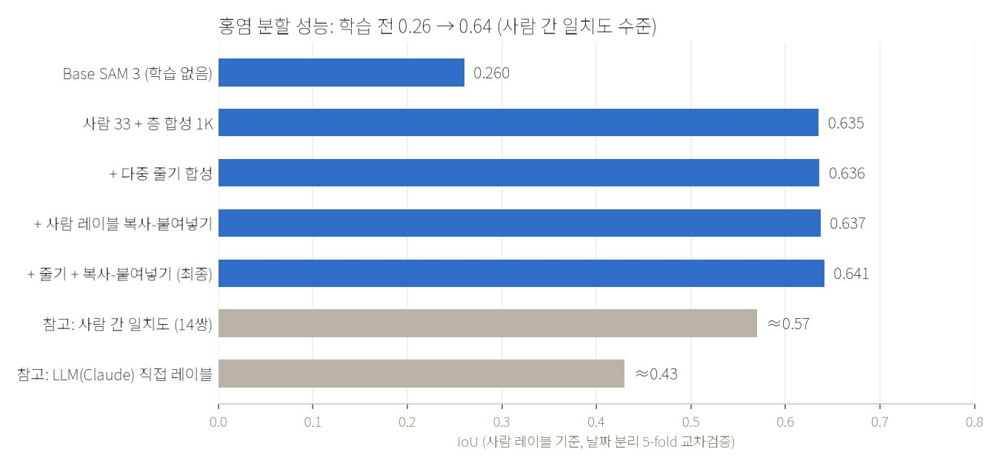
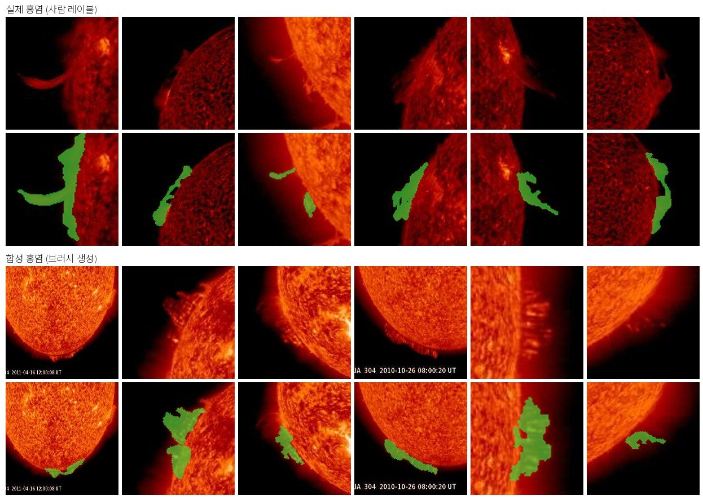
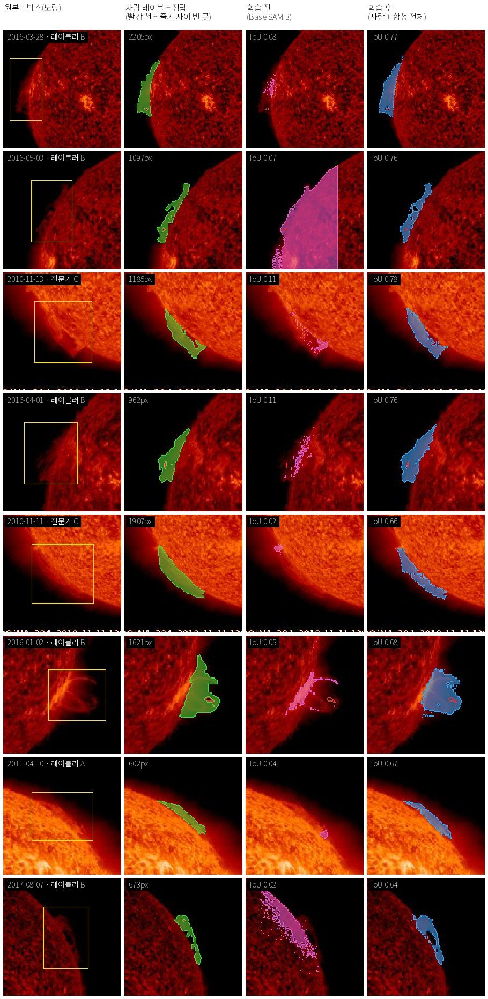
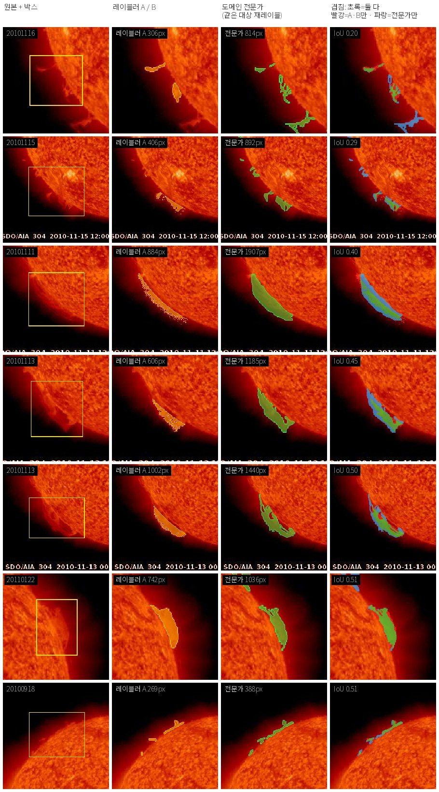
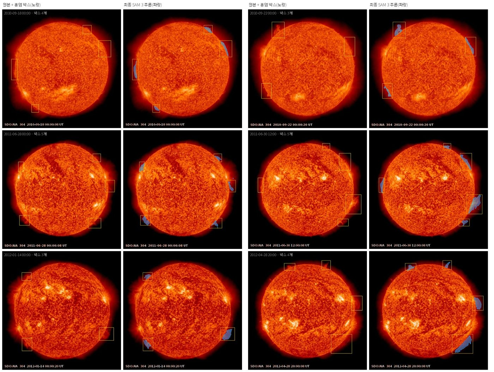

**Role:** Sole owner — designed, built, and operated the whole pipeline: synthetic data engine, fine-tuning, evaluation design, labeling and review services, and large-scale auto-labeling.

#### Challenge

The goal was pixel-level segmentation of **solar prominences** in NASA SDO/AIA 304Å images (512×512).
The source data only had **bounding boxes**, and only domain experts can draw correct masks, so just **33 human labels** were available.
Prominences are faint, branching, semi-transparent, and overlap the bright solar disk; zero-shot SAM 3 either painted the whole disk or caught small fragments (IoU 0.26).
The domain was new to me, so I studied the solar-physics literature and turned physical properties (e.g. "brighter than the sky off-limb, darker on the disk") into prompts, metrics, and synthesis rules.

<figure><figcaption>Cross-validated IoU against human labels: 0.26 → 0.64, above inter-annotator agreement (≈0.57)</figcaption></figure>

#### Approach

- **Model:** SAM 3 with the 454M vision encoder frozen; only the mask decoder and prompt encoder (10.4M) are trained — touching the encoder with a few dozen labels overfits immediately. BCE + Tversky loss, with weights set from the direction of human edits (over- vs. under-segmentation).
- **Synthetic data engine — 10 generators, 9,000+ images, one generator per observed failure mode:** brush shapes derived from human labels (unrolled into polar coordinates around the limb), transparency, blur/diffusion, linear and arc shapes, multi-object overlap, multi-strand structures, thin overlapping arcs, background haze, and copy-paste of real labeled pixels.
- Synthesis follows observation physics: frame-specific AIA 304 colormap, limb-anchored placement, and **every image operation is applied to the label as well**. Synthetic label boundaries are shrunk by 4 px to control label noise; copy-paste synthesis is rebuilt per fold from that fold's training labels only, to prevent leakage.

<figure><figcaption>Real prominences (top) vs. synthetic ones (bottom): shape statistics follow the human labels while position, size, and brightness are widened</figcaption></figure>

#### Evaluation design for a tiny dataset

- **Date-grouped 5-fold cross-validation** — frames from the same day show nearly the same prominence, so random splits inflate scores. All 33 labels are scored once as held-out.
- Measured the **noise floor** first (±0.013 on re-running a fold) and never drew conclusions from smaller differences.
- Measured the **ceiling**: two people labeling the same 14 targets agree at IoU 0.57. The model (0.64) already exceeds it.
- Added purpose-specific metrics beyond IoU: clDice for thin structures, gap recall between strands, and haze false-positive rate. IoU differences between synthetic variants were within noise (reported honestly as "no effect"), but the dedicated metrics showed that multi-strand synthesis raised **gap recall 0.218 → 0.278** and haze synthesis cut **haze false positives 0.105 → 0.020** (on a synthetic eval set, flagged as needing confirmation).

<figure class="fig-half"><figcaption>Largest gains — human label (green), before training (purple), after training (blue)</figcaption></figure>

#### Label quality: diagnosing data problems with data

- Comparing 14 pairs drawn by a labeler and a domain expert showed the expert fills the whole body (1.37× area) while the labeler traces only the bright edge — the **labeling rule, not the model, sets the ceiling**.
- Tested a multimodal LLM (Claude) as a labeler: IoU 0.41–0.44 against humans, below inter-human agreement (0.57) and the fine-tuned model (0.64), so it was **not adopted** — a tool decision made by the numbers.

<figure class="fig-half"><figcaption>Labeler vs. domain expert on the same targets — overlap and IoU per case</figcaption></figure>

#### Human-in-the-loop infrastructure and auto-labeling

- Built and ran **4 labeling/review web services** (Flask + SQLite, systemd + Cloudflare Tunnel, no install for external experts): mask evaluation and brush editing, labeling with the improved model, **blind A/B model comparison**, and a **full review of all 9,241 auto-labels**. Edits flow back into training data with a single script.
- Auto-labeled all **9,241 boxes across 2,920 frames** with 2-GPU sharding in about 36 minutes (28,346 objects across 3 classes in total); 79 cases failing automatic checks are flagged for humans first.
- Engineering under limited resources: moved 22.6 GB of synthetic embeddings to fp16 disk memmaps with lazy loading to run 5 folds in parallel on two 24 GB GPUs; cached frozen-encoder embeddings; fixed seeds and per-fold result files for reproducibility.

<figure><figcaption>Held-out test frames (553 frames · 1,736 boxes): each prominence is segmented per box without spilling onto the disk</figcaption></figure>

#### Changing direction when the evidence changed

- Stopped **self-training** after 3 rounds (+0.006 only) — pseudo-labels carried no new information.
- Removed my own **post-processing rules** after finding they suppressed the fine-tuned model (0.555 → 0.612).
- Chose SAM 3 over SAM 2.1 under identical conditions (0.645 vs. 0.610); tried a label-free DINOv3 anomaly-detection POC and kept it as an auxiliary tool.
- Extended to 3 classes with physics-specific prompts: coronal holes 0.687 → 0.793, sunspots 0.633 → 0.715, prominences 0.444 → 0.641; distilled into compact models (U-Net, DeepLabV3, SegFormer), with SegFormer matching at 10× smaller size.
- When synthetic variants saturated, proposed **agreeing on labeling rules** as the next step instead of more synthesis.

#### Outcome

Raised segmentation accuracy from **IoU 0.26 to 0.64 with only 33 human labels** — above inter-annotator agreement — and turned the model into a production data pipeline: **9,241 objects auto-labeled** and routed through a full human-review service.

**Stack:** SAM 3 / SAM 2.1 (Hugging Face Transformers), DINOv3, U-Net, DeepLabV3, SegFormer · PyTorch, NumPy memmap, OpenCV, scikit-image, SciPy · Flask, SQLite, systemd, Cloudflare Tunnel, HTML Canvas
