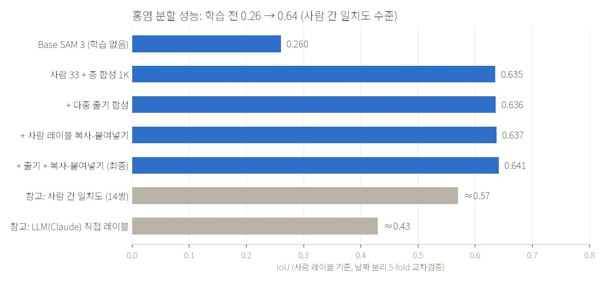
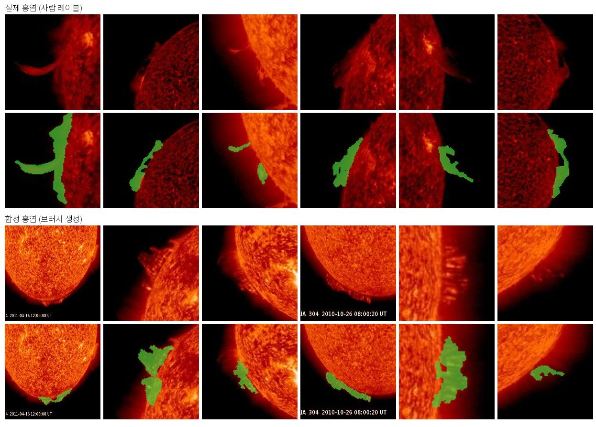
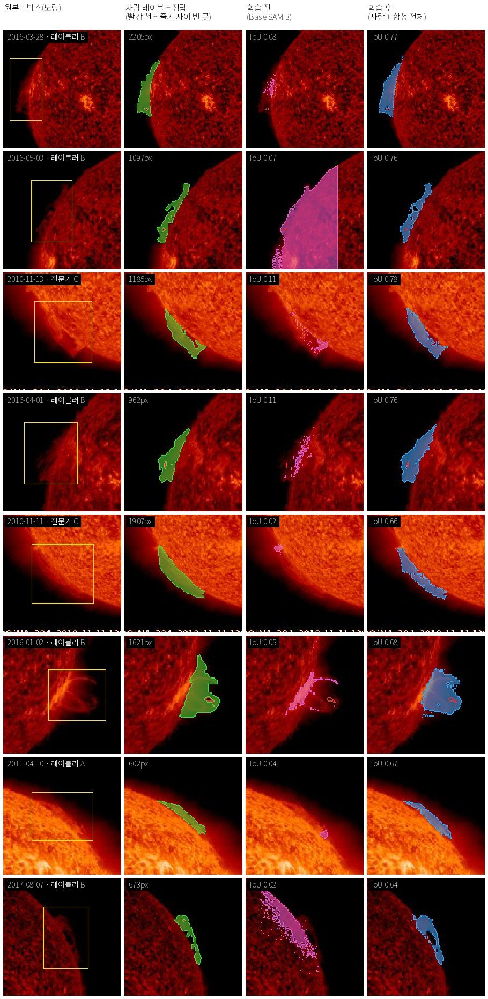
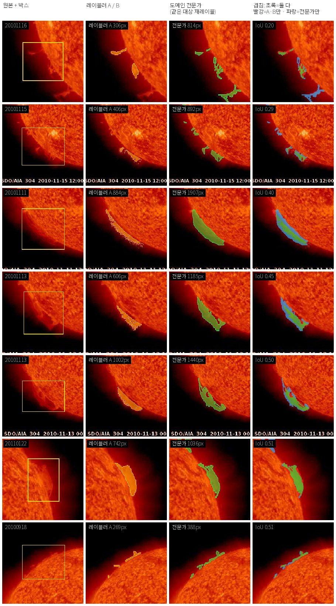
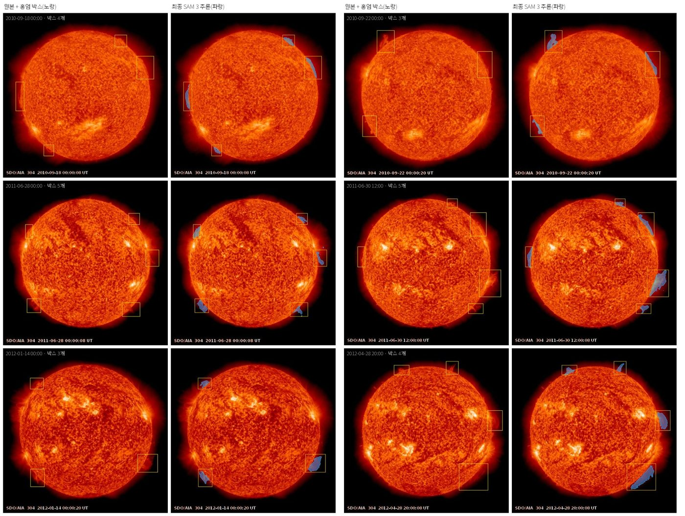

**역할:** 단독 수행 — 합성 데이터 엔진, 파인튜닝, 평가 설계, 레이블링·검수 서비스, 대규모 자동 레이블까지 전 과정을 혼자 설계·구현·운영했습니다.

#### 문제 — 레이블이 없는 도메인

NASA SDO 위성의 태양 관측영상(AIA 304Å, 512×512)에서 태양 가장자리에서 솟는 **홍염(prominence)**을 픽셀 단위로 분할하는 것이 목표였습니다.
원본에는 **박스 레이블만** 있고, 정답 마스크를 그릴 수 있는 사람은 도메인 전문가뿐이라 확보한 사람 레이블은 **33건**이었습니다.
홍염은 희미하고, 가닥이 갈라지고, 반투명하며, 밝은 태양 원반과 겹칩니다. 학습 없는 SAM 3는 원반 전체를 칠하거나 작은 조각만 잡았습니다(IoU 0.26).
저에게도 새로운 도메인이어서, 태양물리 문헌을 조사해 "홍염은 하늘보다 밝고 원반 위에서는 어둡다" 같은 물리적 성질을 프롬프트·검증 지표·합성 규칙으로 옮겼습니다.

<figure><figcaption>사람 레이블 기준 교차검증 IoU 0.26 → 0.64 — 사람 레이블러 간 일치도(≈0.57)를 넘는 수준</figcaption></figure>

#### 접근

- **모델:** SAM 3의 비전 인코더(454M)는 동결하고 mask decoder와 prompt encoder(10.4M)만 학습했습니다. 레이블 수십 건으로 인코더를 건드리면 바로 과적합하기 때문입니다. 손실은 BCE + Tversky이며, 사람이 편집한 마스크의 방향(과검출 vs 미검출)을 분석해 가중치를 정했습니다.
- **합성 데이터 엔진 — 생성기 10종, 9천 장 이상, 실패 유형 하나에 생성기 하나:** 사람 레이블 형상을 림브 기준 극좌표로 펼쳐 변형한 브러시, 투명도, 블러·확산, 직선·아크 도형, 다중 객체 중첩, 다중 줄기, 가는 아크 겹침, 배경 헤이즈, 실제 홍염 픽셀 복사-붙여넣기.
- 합성은 관측 물리를 흉내 냅니다. 프레임별 AIA 304 컬러맵으로 칠하고 림브에 붙여 배치하며, **이미지에 건 연산은 레이블에도 똑같이 겁니다**. 합성 레이블 경계를 4px 줄여 레이블 노이즈를 제어했고, 복사-붙여넣기 합성은 각 fold의 학습 레이블로만 다시 만들어 누수를 막았습니다.

<figure><figcaption>실제 홍염(위)과 합성 홍염(아래) — 실제 레이블의 형상 통계를 따르면서 위치·크기·밝기를 넓힘</figcaption></figure>

#### 작은 데이터에서 믿을 수 있는 평가 만들기

- **날짜 단위로 묶은 5-fold 교차검증.** 같은 날 프레임은 거의 같은 홍염이라 무작위 분할은 점수를 부풀립니다. 33건 전부가 한 번씩 held-out으로 채점됩니다.
- **노이즈 바닥**(같은 fold 재실행 ±0.013)을 먼저 재고, 이보다 작은 차이는 결론에 쓰지 않았습니다.
- **천장**도 측정했습니다. 같은 대상 14쌍의 사람 간 일치도는 IoU 0.57이고, 모델(0.64)은 이미 이를 넘었습니다.
- IoU 외에 clDice, 가닥 사이 빈 곳 재현율, 헤이즈 오검출률을 정의했습니다. 합성 변형 간 IoU 차이는 노이즈 이내라 "효과 없음"으로 정직하게 보고했지만, 목적별 지표에서는 다중 줄기 합성이 **빈 곳 재현율 0.218 → 0.278**, 헤이즈 합성이 **헤이즈 오검출 0.105 → 0.020**(합성 평가셋 기준, 재확인 필요 명시)으로 효과를 보였습니다.

<figure class="fig-half"><figcaption>개선 폭이 큰 사례 — 사람 레이블(초록), 학습 전(보라), 학습 후(파랑)</figcaption></figure>

#### 레이블 품질 — 데이터 문제를 데이터로 진단

- 레이블러와 도메인 전문가가 따로 그린 14쌍을 비교해, 전문가는 몸체 전체를 채우고(면적 1.37배) 레이블러는 밝은 가장자리만 따라 그린다는 것을 확인했습니다. 성능 상한을 정하는 것은 모델이 아니라 **레이블 규칙**이었습니다.
- 멀티모달 LLM(Claude)을 레이블러로 시험했지만 사람과의 IoU가 0.41~0.44로 사람 간 일치도(0.57)와 파인튜닝 모델(0.64)에 못 미쳐 **채택하지 않았습니다** — 새 도구의 도입을 숫자로 결정한 사례입니다.

<figure class="fig-half"><figcaption>같은 대상에 대한 레이블러 vs 도메인 전문가 — 겹침과 사례별 IoU</figcaption></figure>

#### 사람 참여형 인프라와 대규모 자동 레이블

- **레이블링·검수 웹 서비스 4개**를 직접 만들고 운영했습니다(Flask + SQLite, systemd + Cloudflare Tunnel로 외부 전문가에게 설치 없이 배포): 마스크 평가·브러시 편집, 개선 모델 레이블, **블라인드 A/B 비교**, **9,241건 전수 검수**. 편집 결과는 스크립트 하나로 학습 데이터로 회수됩니다.
- 최종 모델로 **2,920프레임 9,241박스**를 2-GPU 샤딩으로 약 36분 만에 레이블했습니다(3개 클래스 누적 28,346건). 자동 검증을 통과하지 못한 79건은 표시해 사람이 먼저 보도록 했습니다.
- 제한된 자원: 합성 임베딩 22.6GB를 fp16 디스크 memmap과 지연 로딩으로 옮겨 24GB GPU 2장에서 5-fold를 병렬로 돌렸고, 동결 인코더 임베딩 캐시, 고정 시드와 fold별 결과 저장으로 재현성을 확보했습니다.

<figure><figcaption>학습에 쓰지 않은 test 프레임(553프레임 · 1,736박스) — 여러 홍염을 박스별로 잡고 원반 쪽으로 번지지 않음</figcaption></figure>

#### 근거가 바뀌면 방향을 바꿨다

- **자기학습** 3회 반복이 +0.006에 그쳐 중단했습니다 — pseudo-label에는 새 정보가 없었습니다.
- 직접 만든 **후처리 규칙**이 파인튜닝 모델을 누른다는 것을 발견하고 제거했습니다(0.555 → 0.612).
- 같은 조건에서 SAM 3(0.645)를 SAM 2.1(0.610)보다 우선 선택했고, 레이블 없는 대안으로 DINOv3 이상 탐지 POC를 수행해 보조 수단으로 정리했습니다.
- 3개 클래스로 확장하며 물리 성질에 맞게 프롬프트를 재설계했습니다: 코로나홀 0.687 → 0.793, 흑점 0.633 → 0.715, 홍염 0.444 → 0.641. U-Net·DeepLabV3·SegFormer로 경량화했고 SegFormer는 10배 작은 크기로 대등한 성능을 냈습니다.
- 합성 변형의 효과가 포화되자 "더 많은 합성" 대신 **레이블 규칙 합의**를 다음 단계로 제안했습니다.

#### 성과

**사람 레이블 33건만으로 IoU 0.26 → 0.64**(사람 간 일치도 이상)를 달성하고, 그 모델을 **9,241개 객체 자동 레이블 + 전수 검수** 데이터 파이프라인으로 연결했습니다.

**기술 스택:** SAM 3 / SAM 2.1(Hugging Face Transformers), DINOv3, U-Net, DeepLabV3, SegFormer · PyTorch, NumPy memmap, OpenCV, scikit-image, SciPy · Flask, SQLite, systemd, Cloudflare Tunnel, HTML Canvas
